<div align="center">

# 🚀 NexOps Enterprise Platform — AWS Cloud Infrastructure

### Production-style, three-tier AWS infrastructure provisioned entirely with Terraform

Deploys and runs the **Enterprise Employee Management System (EEMS)** — a containerized React + Node.js + PostgreSQL application — on a self-healing, load-balanced, auto-scaling AWS backbone.

[](https://www.terraform.io/)
[](https://aws.amazon.com/)
[](https://www.docker.com/)
[](https://www.postgresql.org/)
[](https://nginx.org/)
[](https://aws.amazon.com/amazon-linux-2023/)
[](https://www.gnu.org/software/bash/)

</div>

---

## 📋 Table of Contents

- [Tech Stack](#-tech-stack)
- [Architecture](#-architecture)
- [Project Structure](#-project-structure)
- [Prerequisites](#-prerequisites)
- [Step-by-Step: Deploy](#-step-by-step-deploy)
- [Verify It's Actually Live](#-verify-its-actually-live)
- [Monitoring & Alerts](#-monitoring--alerts)
- [Troubleshooting — Things That Actually Went Wrong](#-troubleshooting--things-that-actually-went-wrong)
- [Tear Down](#-tear-down)
- [Documentation](#-documentation)
- [What This Demonstrates](#-what-this-demonstrates)

---

## 🛠 Tech Stack

| Layer | Technology |
|---|---|
| **Infrastructure as Code** | Terraform (modules, remote state, workspaces-ready) |
| **Compute** | EC2 (Amazon Linux 2023), Auto Scaling Group, Launch Template |
| **Networking** | VPC, public/private subnets across 2 AZs, NAT Gateway, Internet Gateway, Route Tables |
| **Load Balancing** | Application Load Balancer, Target Groups, HTTP→HTTPS redirect, Health Checks |
| **Database** | RDS PostgreSQL, Secrets Manager |
| **Storage** | S3 (encrypted, versioned, private) |
| **Containers** | Docker, Docker Hub |
| **Reverse Proxy** | Nginx |
| **Serverless** | AWS Lambda, EventBridge |
| **Monitoring** | CloudWatch Alarms, SNS (email alerts) |
| **Security** | IAM least-privilege roles, Security Groups, SSM Session Manager (no SSH) |
| **Entry point** | Application Load Balancer (HTTP, ALB DNS name) |\n| **Access Control** | AWS CLI, IAM users/policies |

---

## 🏗 Architecture

See [`diagrams/architecture.md`](diagrams/architecture.md) for the full diagram and network layout breakdown.

**High-level flow:** Application Load Balancer (public subnets) → Auto Scaling Group of EC2 instances (private app subnets, min 2 for high availability) → Nginx reverse proxy → Docker Hub EEMS images (React frontend + Node.js backend) → RDS PostgreSQL (private DB subnets) + S3 (uploads) + Secrets Manager (credentials). The app is accessed via the ALB DNS name (no Route 53).

<p align="center">
  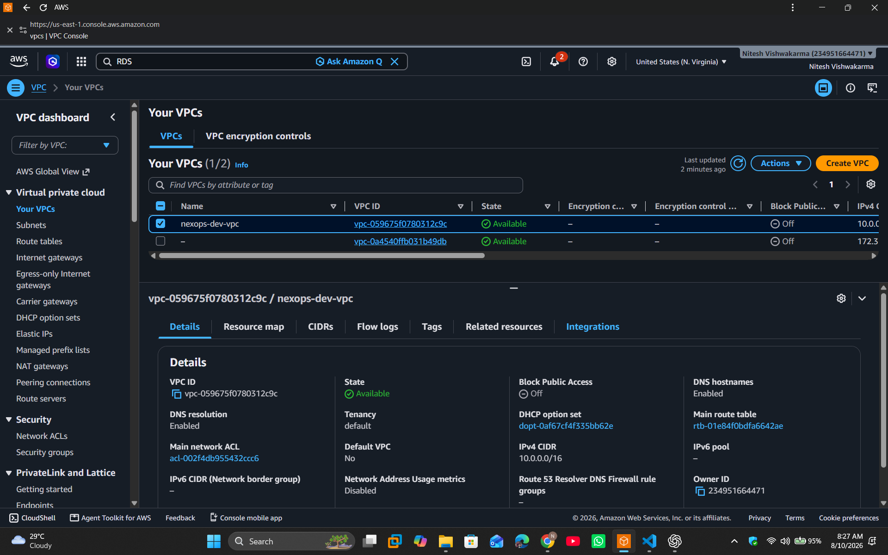
</p>

---

## 📁 Project Structure

<p align="center">
  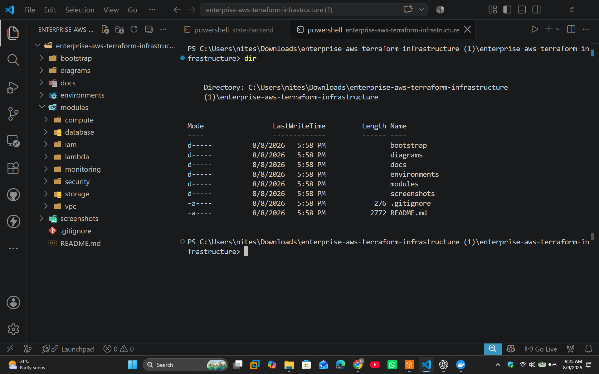
</p>

```
enterprise-aws-terraform-infrastructure/
│
├── bootstrap/state-backend/   # one-time: S3 + DynamoDB for remote Terraform state
├── modules/
│   ├── vpc/            # VPC, subnets, routing, NAT
│   ├── security/         # security groups (ALB / app / db tiers)
│   ├── iam/               # Lambda execution role
│   ├── database/          # RDS PostgreSQL + Secrets Manager
│   ├── storage/           # S3 uploads bucket
│   ├── compute/           # ALB, Launch Template, Auto Scaling Group, EC2 IAM role
│   ├── lambda/             # scheduled housekeeping function
│   └── monitoring/         # SNS + CloudWatch alarms
├── environments/dev/        # root config: wires all modules together
├── diagrams/architecture.md
├── docs/                    # deployment guide, incident postmortem, troubleshooting, interview Q&A
└── screenshots/
```

---

## ✅ Prerequisites

<p align="center">
  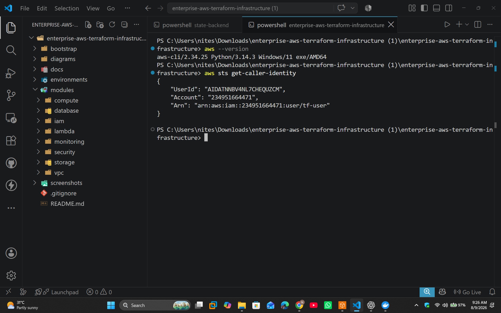
  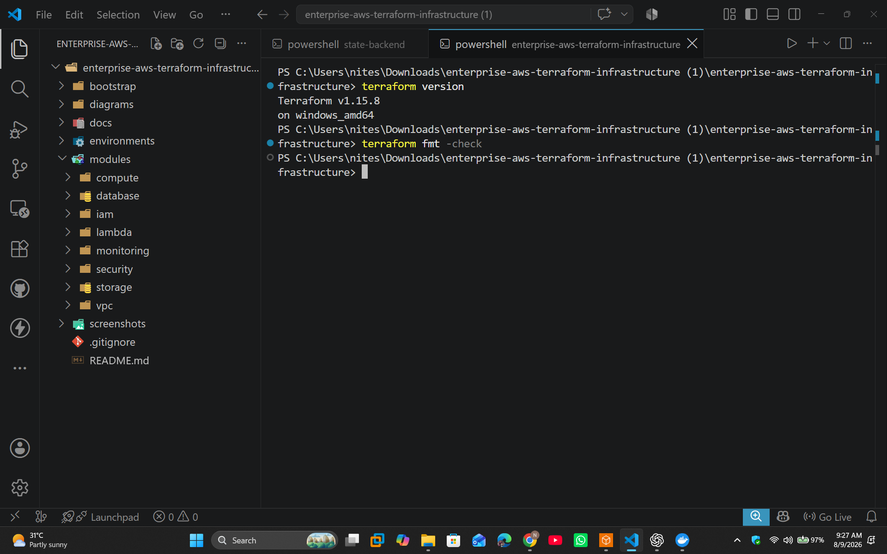
</p>

- **Terraform** ≥ 1.6.0 — verify with `terraform version`
- **AWS CLI v2**, configured with credentials — verify with `aws sts get-caller-identity`
- An **AWS account** (dev/sandbox recommended)
- **Docker Hub account** with the application images already pushed (see below)

<p align="center">
  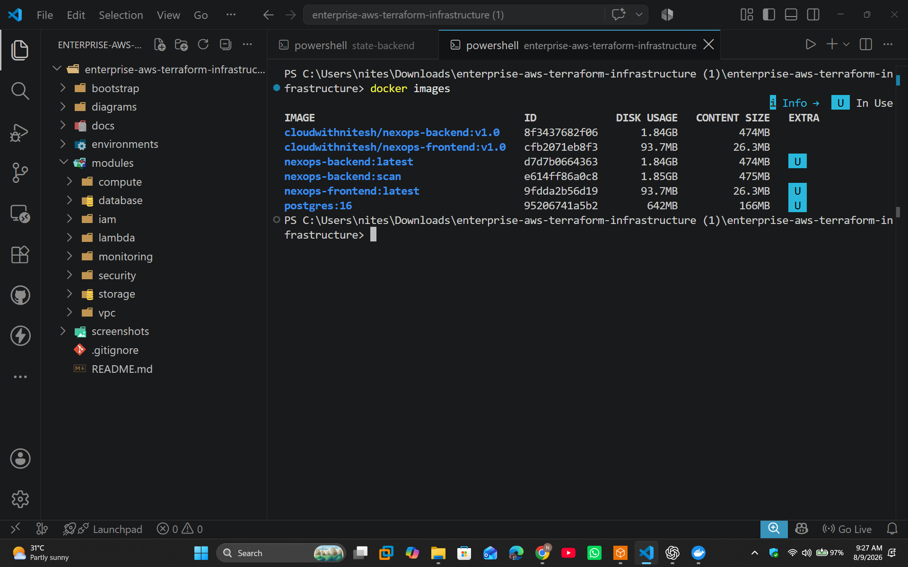
</p>

---

## 🚀 Step-by-Step: Deploy

### 1. Bootstrap the remote state backend *(one-time, per AWS account)*

```bash
cd bootstrap/state-backend
terraform init
```
<p align="center">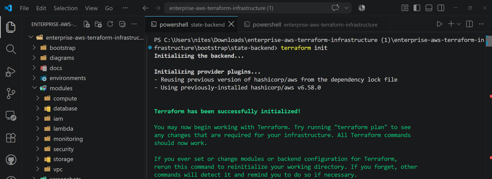</p>

```bash
terraform validate
```
<p align="center">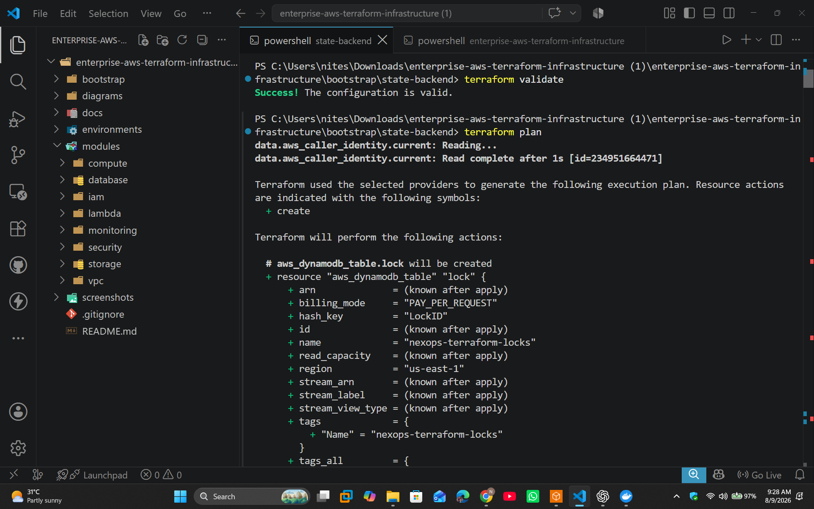</p>

```bash
terraform plan
```
<p align="center">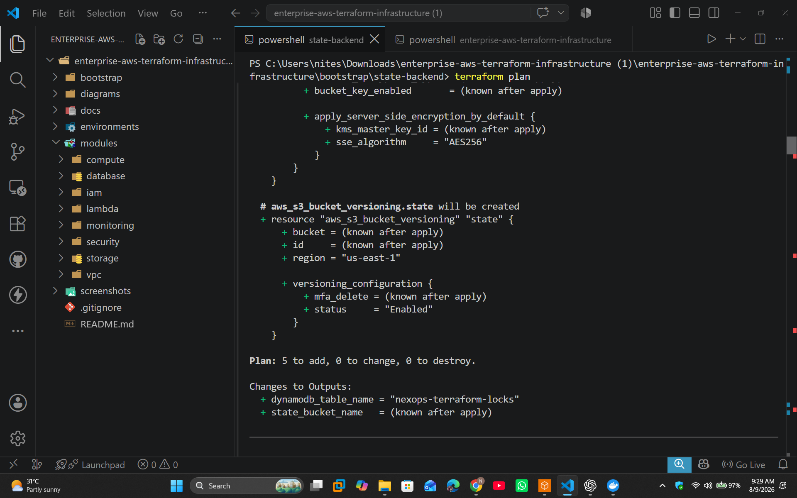</p>

```bash
terraform apply
```
<p align="center">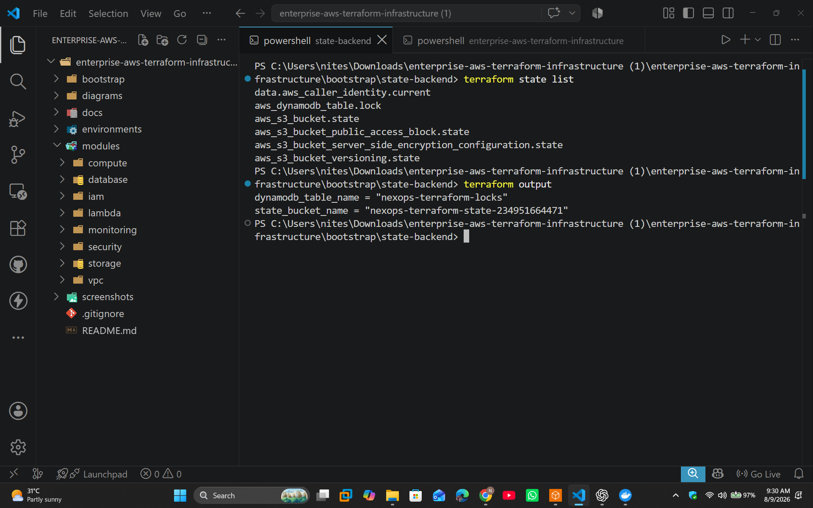</p>

Note the `state_bucket_name` and `dynamodb_table_name` outputs — you need both for the next step.

### 2. Point the environment at that backend

Edit `environments/dev/backend.tf`, replacing the placeholder with your real bucket name:
```hcl
terraform {
  backend "s3" {
    bucket         = "nexops-terraform-state-<YOUR_ACCOUNT_ID>"
    key            = "environments/dev/terraform.tfstate"
    region         = "us-east-1"
    dynamodb_table = "nexops-terraform-locks"
    encrypt        = true
  }
}
```

### 3. Configure your variables

```bash
cd ../../environments/dev
cp terraform.tfvars.example terraform.tfvars
```

Fill in `alert_email`, `db_name`, `db_username`, `backend_image`, and `frontend_image`.

No domain variables are needed. The stack runs on the ALB DNS name over HTTP; there is no Route 53 or ACM.

### 4. Deploy the main infrastructure

```bash
terraform init
```
<p align="center">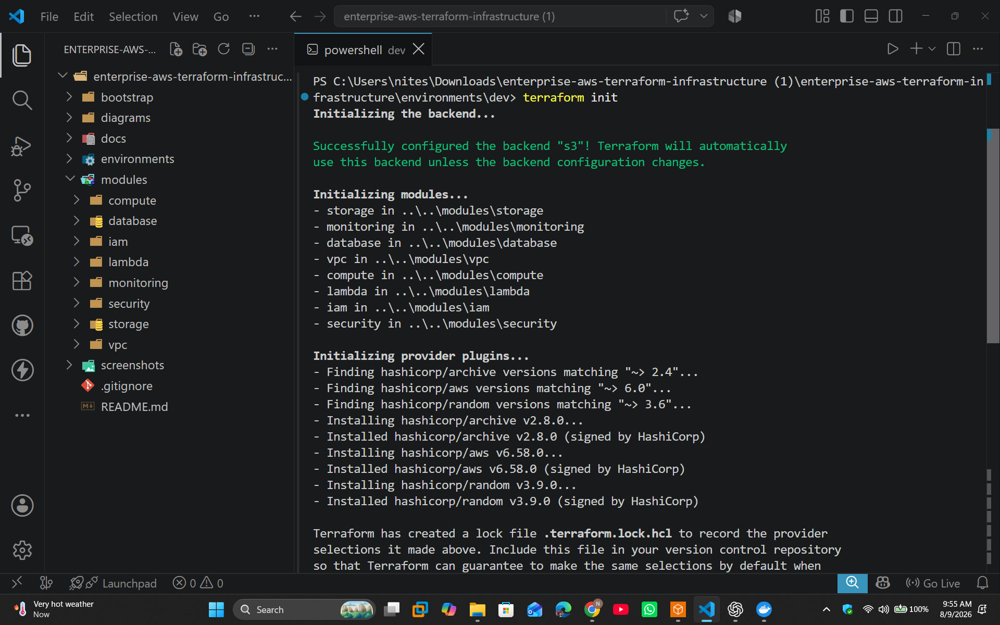</p>

```bash
terraform validate
```
<p align="center">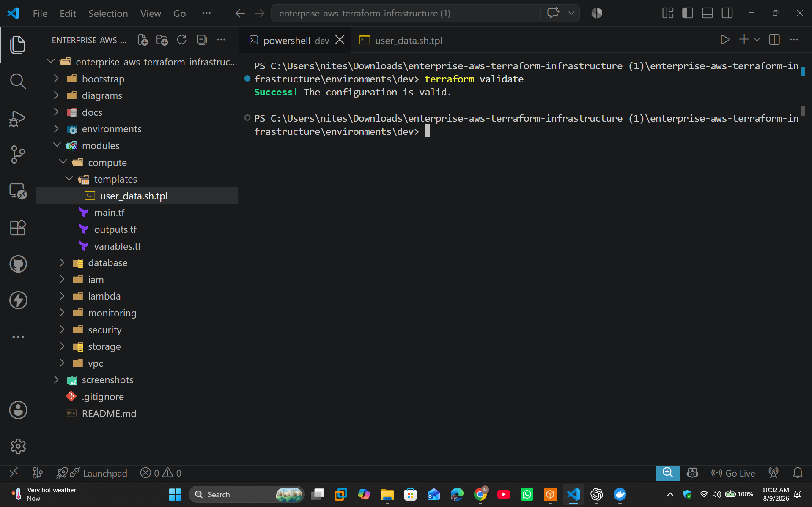</p>

```bash
terraform plan
```
<p align="center">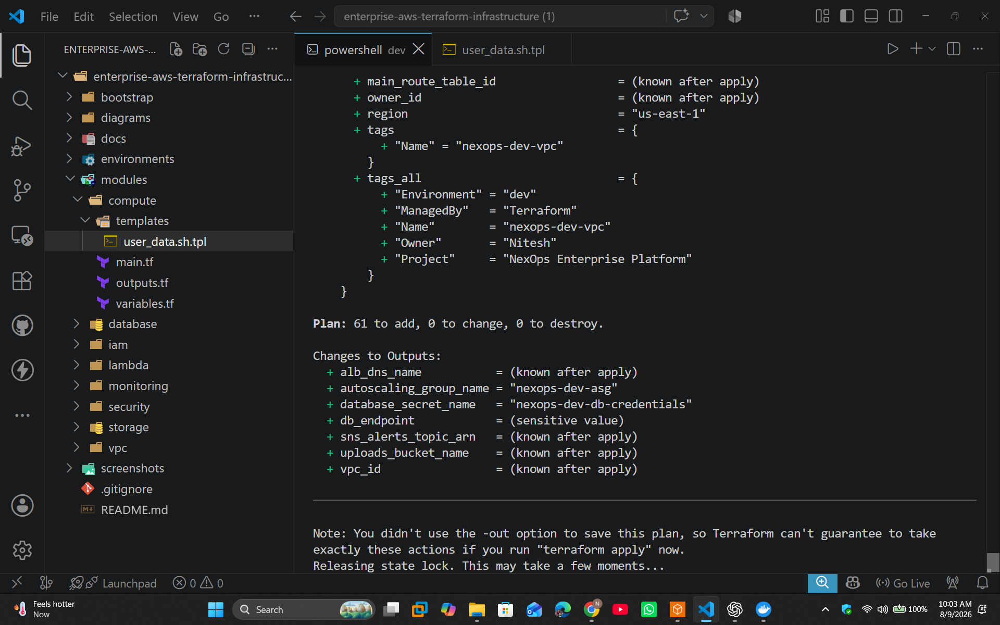</p>

```bash
terraform apply
```
Type `yes` and wait — RDS is the slowest resource (~5 minutes).
<p align="center">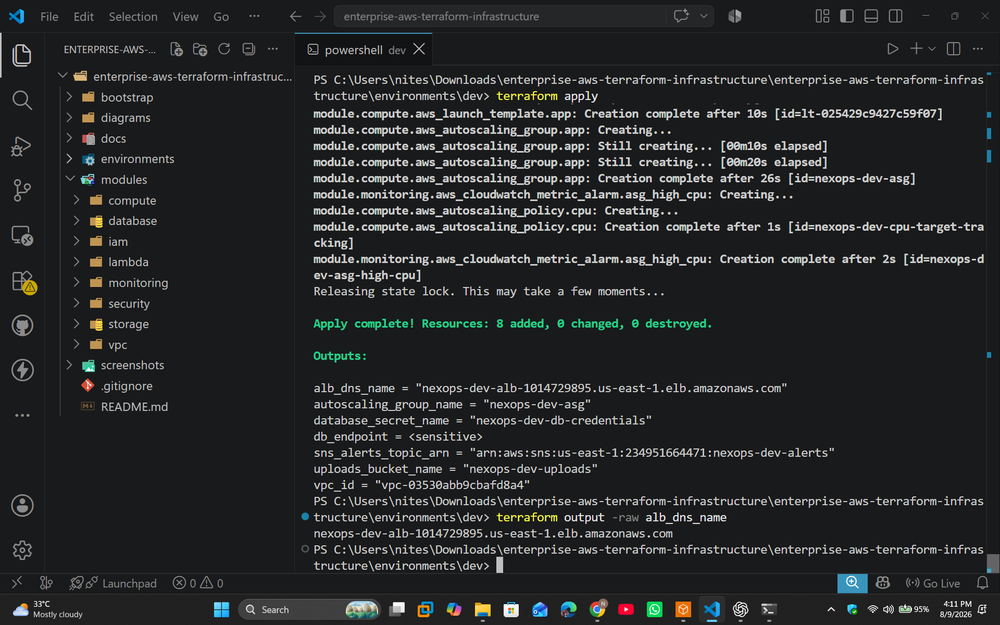</p>

---

## 🌐 Accessing the Application (ALB only)

Traffic reaches the app directly through the public Application Load Balancer:

```text
Internet → ALB :80 (public subnets) → Private EC2 ASG → Nginx → containers → RDS / S3
```

Get the URL with:

```bash
terraform output application_url
```

Example: `http://nexops-dev-alb-123456789.us-east-1.elb.amazonaws.com`

Route 53, ACM and a custom domain are not used. If you want HTTPS/a custom domain later, add an ACM certificate + HTTPS listener to the ALB and a DNS record at your DNS provider.

## 🔍 Verify It's Actually Live

**Check the Auto Scaling Group has 2 healthy instances** (not 1 — see [`docs/HOW_ALB_ASG_CLOUDWATCH_WORK.md`](docs/HOW_ALB_ASG_CLOUDWATCH_WORK.md) for why that matters):
<p align="center">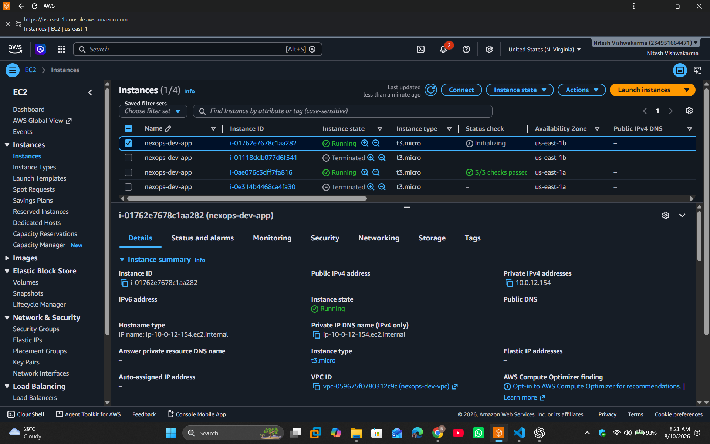</p>

**Check the target group shows both targets healthy:**
<p align="center">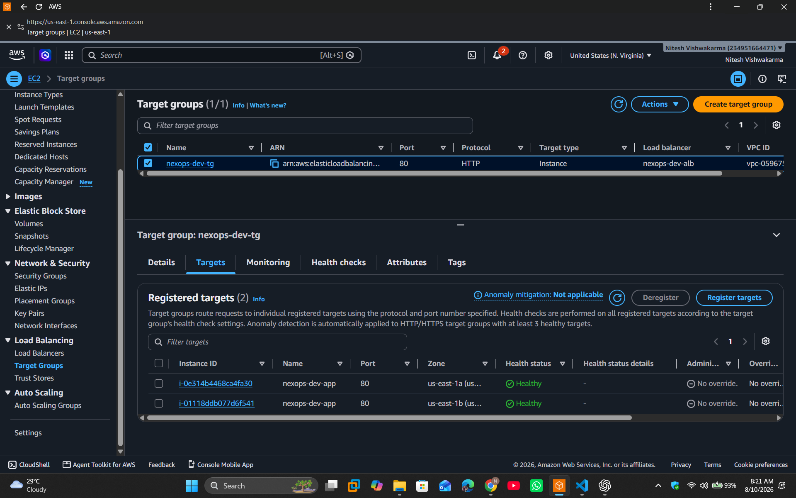</p>

**Check the Load Balancer itself:**
<p align="center">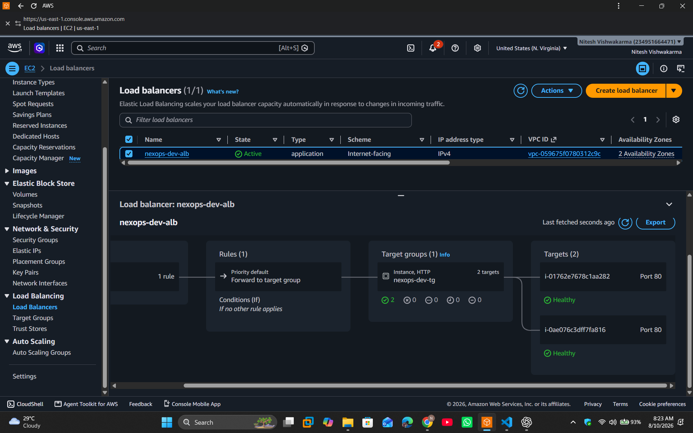</p>

**Check the application through the ALB:**

```bash
curl -i $(terraform output -raw application_url)/api/health
```

Then open `terraform output application_url` in a browser.

**Check RDS PostgreSQL is running:**
<p align="center">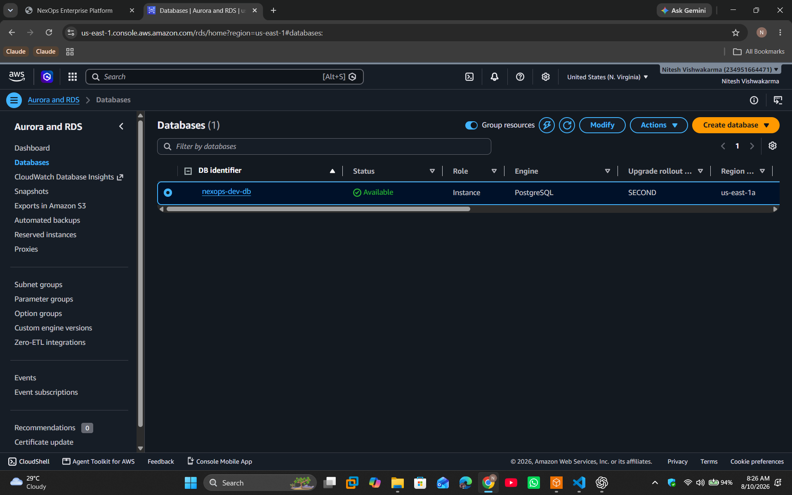</p>

**Get the live URL:**
```bash
terraform output alb_dns_name
```
<p align="center"></p>

**Open it in a browser — the application is live:**
<p align="center">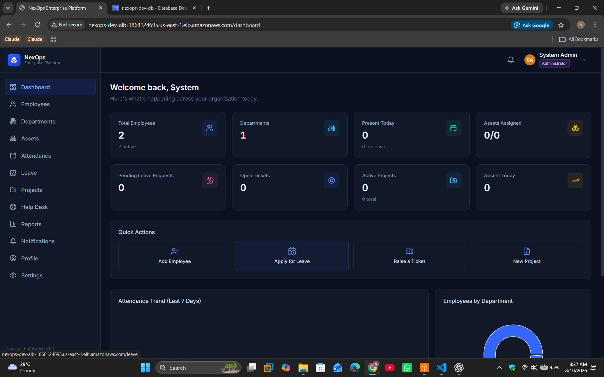</p>

**All provisioned resources at a glance:**
<p align="center">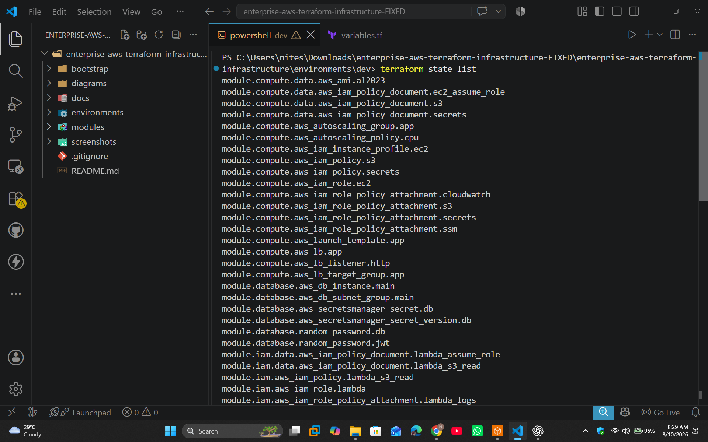</p>

---

## 📈 Monitoring & Alerts

CloudWatch alarms (ASG CPU, ALB 5xx errors, ALB unhealthy hosts, RDS CPU, RDS storage) publish to an SNS topic that emails you on state changes. Confirm the subscription email when it arrives:

<p align="center"></p>

See [`docs/HOW_ALB_ASG_CLOUDWATCH_WORK.md`](docs/HOW_ALB_ASG_CLOUDWATCH_WORK.md) for how the ALB, ASG, and these alarms work together end to end.

---

## 🧹 Tear Down

When you're done — this stack costs real money while running (NAT Gateway + RDS + EC2):

```bash
cd environments/dev
terraform destroy
```
<p align="center"></p>

The state backend (`bootstrap/state-backend`) is left in place intentionally (`prevent_destroy` on the state bucket) — destroy it manually and separately only if fully decommissioning the account.

---

## 🩹 Troubleshooting — Things That Actually Went Wrong

Real errors hit during first deployment, in the order you're likely to hit them. `docs/INCIDENT_POSTMORTEM.md` and `docs/TROUBLESHOOTING.md` cover more; this is the short version for the most common ones.

### `terraform apply` fails with `dial tcp: lookup ...: no such host` (for S3 / STS)
Your machine's own network/DNS dropped mid-apply — not an AWS or code problem. This project's apply can take 8-10+ minutes uninterrupted, so an unstable Wi-Fi connection, VPN, or laptop network-adapter sleep setting will surface as this exact error at a different AWS service each time.
- Test with `ping 8.8.8.8 -n 20` — any packet loss confirms it's your connection, not AWS.
- Disable Wi-Fi adapter power saving (Control Panel → Network Connections → adapter Properties → Power Management → uncheck "allow the computer to turn off this device").
- Disconnect any VPN/proxy for the duration of the apply.
- If it keeps happening, run Terraform from **AWS CloudShell** in the console instead of your laptop — it can't suffer from local network drops since it runs inside AWS's network.

### `Error acquiring the state lock`
Left over from a previous apply that was interrupted (e.g. by the network issue above). The error message includes a Lock ID:
```bash
terraform force-unlock <LOCK_ID>
```
If the local recovery file `errored.tfstate` also got written, reconcile it before continuing: `terraform state push errored.tfstate` (only if `terraform state pull` doesn't show a newer version already in the backend).

### `creating Secrets Manager Secret: ... already scheduled for deletion`
A secret from an earlier interrupted run is stuck in its recovery window. Since this is a dev environment, just remove it permanently instead of waiting:
```bash
aws secretsmanager delete-secret --secret-id nexops-dev-db-credentials --force-delete-without-recovery
```

### ASG shows healthy but the target group never does / instances keep cycling / browser shows 502
Check `HealthCheckType` on the ASG:
```bash
aws autoscaling describe-auto-scaling-groups --auto-scaling-group-names nexops-dev-asg --region us-east-1 --query "AutoScalingGroups[0].HealthCheckType"
```
It must be `ELB` (checks the target group), not `EC2` (checks only that the instance is running, ignoring the app entirely). If it drifted to `EC2`, a plain `terraform apply` reconciles it back to what's in `modules/compute/main.tf`. Also confirm `health_check_grace_period` is generous enough (480s+) for the full boot script — `dnf update`, Docker install, two image pulls, and the Prisma readiness wait easily take longer than the default 120s on a `t3.micro`, which causes the ASG to kill instances before they ever finish booting.

### `curl http://localhost/api/health` on the instance gets `Connection refused`, but `docker ps` shows both containers `Up`
The containers are fine — `nginx` never started. Check:
```bash
sudo systemctl status nginx
sudo nginx -t
```
If the boot script errored out before reaching the "configure and start nginx" step (commonly because the backend readiness check timed out), nginx is left `enabled` but never actually started. Fix the underlying cause in `user_data.sh.tpl` (see next two items), then either wait for the ASG to naturally replace the instance or manually finish bootstrapping it over SSM.

### Backend logs show `PrismaClientKnownRequestError: The table 'public.User' does not exist`
The database schema was never pushed — this happens whenever the boot script's `prisma db push` step got skipped (e.g. because nginx/backend setup failed earlier in the same boot). Fix on the running instance:
```bash
aws ssm start-session --target <instance-id>
sudo docker exec nexops-backend sh -c 'export DIRECT_URL="$DATABASE_URL" && npx prisma db push --skip-generate'
```

### `prisma db push` fails with `Environment variable not found: DIRECT_URL`
This app's Prisma schema expects both `DATABASE_URL` and `DIRECT_URL`. Since this project's RDS instance isn't behind a connection pooler, both can be the same value. Add this line to the `docker run` command for `nexops-backend` in `modules/compute/templates/user_data.sh.tpl`, right after the existing `DATABASE_URL` line, so every future instance sets it automatically:
```bash
  -e DIRECT_URL="$DATABASE_URL" \
```

### Login shows "Invalid email or password" / 500 error on `/api/auth/login`
- 500 error → check `sudo docker logs nexops-backend` on the instance; usually the missing-table error above.
- "Invalid email or password" → the account genuinely doesn't exist yet in this database. The seed step only runs automatically during a successful boot; if earlier boots failed before reaching it (see nginx/DIRECT_URL items above), no demo accounts were ever created. Create them manually over SSM using the same upsert logic in `user_data.sh.tpl` lines ~142-184, or re-trigger a full instance refresh once the script itself is fixed so new instances seed themselves correctly.

---

## 📚 Documentation

| Doc | What it covers |
|---|---|
| [`docs/DEPLOYMENT_GUIDE.md`](docs/DEPLOYMENT_GUIDE.md) | Full deploy/teardown steps |
| [`docs/INCIDENT_POSTMORTEM.md`](docs/INCIDENT_POSTMORTEM.md) | Every real bug hit on first deploy — root causes and exact fixes |
| [`docs/HOW_ALB_ASG_CLOUDWATCH_WORK.md`](docs/HOW_ALB_ASG_CLOUDWATCH_WORK.md) | How the ALB, ASG, and CloudWatch alarms actually work together |
| [`docs/TROUBLESHOOTING.md`](docs/TROUBLESHOOTING.md) | Common failure modes |
| [`docs/INTERVIEW_QA.md`](docs/INTERVIEW_QA.md) | Talking points for explaining this design |
| [`diagrams/architecture.md`](diagrams/architecture.md) | Architecture diagram + network layout |

---

## 💡 What This Demonstrates

- Infrastructure as Code with modular, reusable Terraform (VPC, security, IAM, database, storage, compute, Lambda, monitoring as independent modules)
- Remote state management with S3 + DynamoDB locking, bootstrapped separately from the main stack
- High availability: multi-AZ Auto Scaling Group behind an Application Load Balancer, zero-downtime rolling deploys via instance refresh
- Least-privilege IAM, no SSH (SSM Session Manager only), private subnets for app + database tiers
- Secrets management via AWS Secrets Manager — no credentials hardcoded or baked into images
- Proactive monitoring: CloudWatch alarms → SNS → email, before a user ever reports a problem
- Real incident response — see [`docs/INCIDENT_POSTMORTEM.md`](docs/INCIDENT_POSTMORTEM.md) for genuine bugs hit and fixed during first deployment, not a sanitized success story

---

<div align="center">

Built by **Satyam** as part of a multi-project cloud/DevOps portfolio.

</div>